# orchard-irrigation-ml

A classical ML decision-support prototype for irrigation on a real 1,600-tree
family orchard in Nashik, Maharashtra — built on a transparent synthetic
simulation, driven by real weather, with the assumptions and limitations
stated rather than hidden.

## What you're looking at

Irrigation on the orchard today is entirely manual: someone walks the
blocks and decides based on soil dampness, how long it's been since the
block was last watered, the season, and whether it has rained recently.
This project asks a narrower question: **could a classical ML model
approximate that judgment from the same kind of information a person
would actually have, and how would you know if it was any good?**

There are no historical irrigation records and no soil sensors on the
orchard, so there's no real dataset to train on. Instead, this builds a
synthetic one: a day-by-day water-balance simulation per block, driven by
**real historical weather for Nashik** (not invented numbers), with a
documented, inspectable rule deciding the label each day. A classical
model is then trained to approximate that rule from noisy, realistically
available observations — not from the exact internal state the rule
itself used, which would make the whole exercise circular.

The live app does two different things, deliberately kept separate:

- **Today tab** — a plain-language dashboard: which blocks need attention
  today, which are trending toward needing water this week, driven by a
  manually entered starting condition plus the real weather forecast for
  Nashik. Built to be usable by someone managing the orchard, not just
  someone reading code.
- **Model details tab** — the evidence: evaluation metrics, a confusion
  matrix, feature importances, and real example predictions including a
  genuine failure case, all computed on held-out historical data.

The live dashboard does **not** run the trained classifier. There is no
sensor feed to hand it, so doing that would mean feeding it placeholder
numbers dressed up as real readings. The dashboard runs the same
deterministic policy the training labels came from, forward from a
manually entered starting point, using real current and forecast weather.
The classifier's accuracy claim is validated separately, on historical
data where real observed features and real labels both exist. This
split is explained again, briefly, at the point in the app where it
matters.

## Architecture

```mermaid
flowchart TD
    subgraph TRAIN["Training & evaluation — historical weather"]
        HW[("Real historical weather<br/>Nashik, 488 days")] --> SIM1["Simulator<br/>daily water balance"]
        SIM1 --> TRUE["True state<br/>moisture, stress"]
        TRUE --> POL1["Policy<br/>deterministic rule"]
        POL1 --> LABEL["Label<br/>None / Monitor / Irrigate"]
        TRUE -. "+ noise" .-> OBS["Observed features<br/>what a person could check"]
        OBS --> CLF["Classifier<br/>trained on Observed -> Label"]
        LABEL --> CLF
        CLF --> EVAL["Evaluation<br/>Model details tab"]
    end

    subgraph LIVE["Live app — forecast weather"]
        FW[("Real 7-day forecast<br/>Open-Meteo, Nashik")] --> SIM2["Simulator<br/>same code, forward"]
        START["Starting condition<br/>picked by the user"] --> SIM2
        SIM2 --> TRUE2["Projected state<br/>per day, per block"]
        TRUE2 --> POL2["Policy<br/>same rule"]
        POL2 --> TIMELINE["7-day risk timeline<br/>Today tab"]
    end
```



The classifier is deliberately absent from the live path — see "What
you're looking at" above for why.

```
blocks.py            12 synthetic blocks covering all 1,600 real trees,
                      grouped by species, age cohort, and soil profile
simulate.py           the water-balance physics: pure, tested functions,
                      no decision logic
policy.py              the deterministic ground-truth irrigation rule,
                      zero ML, fully inspectable
features.py             the leakage guard: the single place that defines
                      what the model is and isn't allowed to see
fetch_weather.py          pulls real historical Nashik weather (run once)
generate_dataset.py        ties simulate.py + policy.py together day by
                      day, including irrigation feeding back into the
                      next day's state; produces data/orchard_dataset.csv
model.py                baselines, the classifier, the temporal split,
                      evaluation
project.py                the live week-ahead projection: same simulator
                      and policy, driven by a real weather forecast
app.py                   the Streamlit dashboard
tests/                    43 tests across every module above
```

## The policy: how the labels are generated

| Condition | Decision | Why |
|---|---|---|
| Water stress index < 0.35 | No irrigation | Plenty of buffer left |
| 0.35 ≤ stress < 0.60 | Monitor | Worth attention, not yet urgent |
| Stress ≥ 0.60 | Irrigate | At the threshold |
| Stress ≥ 0.60 **and** ≥10mm rain in the last 2 days | Monitor (downgraded) | Ground is visibly wet — wait and see rather than mechanically follow a rule the rain hasn't finished draining through |

The stress index comes from a single-layer soil-moisture bucket model:
moisture rises with rainfall and irrigation, falls with real crop
evapotranspiration (actual FAO-56 reference ET from Open-Meteo × a
species-specific demand coefficient), and drains when it exceeds the
block's root-zone capacity. There is no hardcoded month rule — season
enters only through real weather driving the physics, specifically so the
model can't shortcut to "what month is it" instead of reading conditions.
The thresholds and species parameters are illustrative modeling
assumptions, not validated agronomic data, and are kept in one place
(`policy.py`, `blocks.py`) so they can be inspected and challenged rather
than buried in a larger pipeline.

Only "Irrigate" actually applies water in the simulation. "Monitor" means
closer attention, not a partial watering — there's no defensible rule for
what a lighter irrigation volume would be, so none is claimed.

## Evaluation

Full write-up in [`eval/eval_report.md`](eval/eval_report.md). Headline
numbers, on a temporal holdout (4,524 train rows, 1,092 test rows):

| Model | Macro F1 | Ordinal MAE |
|---|---|---|
| Majority class | 0.274 | 0.348 |
| Season-only (month alone) | 0.509 | 0.240 |
| Direct rule applied to observed features | 0.819 | 0.082 |
| **Random forest, full features** | **0.816** | **0.075** |
| Random forest, weather+block only | 0.546 | 0.323 |

Two things worth highlighting:

- **Not a calendar lookup.** Season-only reaches 0.509, far below the full
  model's 0.816 — removing the soil-check and stress-rating features (the
  ablation row) drops performance by almost as much, confirming the model
  depends on them rather than getting by on weather and species alone.
- **Zero two-step misses** on the test set. The model never predicts "No
  irrigation" when the true label was "Irrigate," or the reverse — every
  error is a one-step confusion with the adjacent class. It over-flags
  rather than under-flags (recall 0.80 vs. precision 0.51 on the rare
  Irrigate class), the safer direction for a water-stress tool.

**Split note:** a plain chronological tail-cut was tried first and
rejected — with only one annual cycle of data, the tail lands entirely in
a monsoon stretch with almost no "Irrigate" examples, making that class
impossible to evaluate. The split instead holds out the last ~20% of days
*within each calendar month*, per block — order preserved at the scale
that matters, every season represented in both train and test. A real
multi-year dataset wouldn't need this; it's a stated tradeoff of the
single-cycle scope, not a hidden one.

## Run locally

```bash
python -m venv .venv && source .venv/bin/activate
pip install -r requirements.txt
python fetch_weather.py       # pulls real historical Nashik weather (no key needed)
python generate_dataset.py    # runs the simulation, writes data/orchard_dataset.csv
pytest tests/                 # 43 tests
python model.py                # prints the evaluation table
streamlit run app.py
```

No API keys anywhere in this repo — Open-Meteo's historical and forecast
APIs are both free and don't require one.

## Deploy for free

1. Push this repo to GitHub.
2. Go to [share.streamlit.io](https://share.streamlit.io), create a new
   app from this repo, `app.py` as the entry point, Python 3.11.
3. Deploy — no secrets to configure.

## What this isn't

The labels are generated from an authored rule, not observed irrigation
decisions — agreement with them shows the model can approximate that
rule, not that the rule reflects real orchard water needs. The simulation
covers one synthetic annual cycle; a second year of real weather could
tell a different story, and the evaluation split above is a stated
workaround for not having one. Species parameters and policy thresholds
are illustrative, not validated agronomic science. Nothing here has been
checked against real irrigation outcomes, and nothing in this repo
controls an actual irrigation system — every "decision" is a label on a
dashboard, a human makes the actual call.

## Part of a set

This is the third of three small, honest projects exploring the same
underlying question from different angles — what evidence justifies
trusting a system's output enough to act on it:

- **[RAG evaluation harness](https://github.com/jayeshb-iiml/RAG-LangChain)** — how do you evaluate retrieval and a generated answer?
- **[Agent autonomy journey](https://github.com/jayeshb-iiml/agent-autonomy-journey)** — when should an agent act versus wait for a human, and how is that trust earned or lost?
- **This repo** — when labels and sensor data don't exist, how do you build and honestly evaluate a model anyway, and what's the gap between "the model matches its own synthetic rule" and "the model should inform a real decision"?
